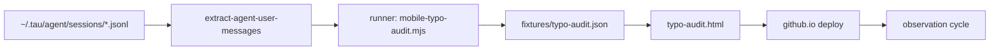

# THE TYPO AUDIT — maximal programme of record

> The agentic-moment project&rsquo;s self-observation arm. Turns the operator&rsquo;s
> ~42k message corpus into a **repeatable, measured, deployed** mobile-typo
> audit: harvest → classify → present → deploy → watch.

**Owner:** tau (agentic-moment pen, `products/site`)
**Status:** partially live (page pushed to Pages; deploy verify pending)

---

## 1. Why this is a programme, not a one-off

A one-shot "here are your typos" page dies the moment it&rsquo;s viewed. The durable
asset is the **loop**: new messages accrue, the analyzer re-runs, the numbers
move, the page redeploys. `git log` grows with each cycle. This plan makes the
loop explicit and each cycle measurable.

---

## 2. The pipeline



## 3. Phases

### Phase A — Harvest ✅ (done)
| item | status |
|------|--------|
| Extract 42,762 user messages / 642 sessions | done |
| Output: `/tmp/tau-user-messages.txt` | done |
| Skill: `extract-agent-user-messages` | exists |

### Phase B — Classify ✅ (done, iterated 4×)
| item | status |
|------|--------|
| Self-vocabulary method (no external-dict bias) | done |
| Mechanisms: neighbor-key / letter-drop / substitution / insertion / transposition | done |
| Target-dominance filter (rare-but-correct never flagged) | done |
| **2.5s runtime** (variant-gen + Set membership, no O(n²) lev) | done |
| Output: `bin/mobile-typo-audit.mjs` | done |
| Numbers: vocab 16,080 · 6,274 near-miss tokens · 25,238 occurrences | done |

### Phase C — Present ✅ (page built)
| item | status |
|------|--------|
| `products/site/compare/typo-audit.html` (self-contained, dark/gold) | done |
| Stat grid (42,762 / 16,080 / 6,274 / 25,238) | done |
| Mechanism distribution bars | done |
| "Genuine mobile signatures" table | done |
| Per-mechanism top-offenders tables | done |
| Footer: reproducible command | done |
| **Render smoke-tested** (chromium headless → screenshot verified) | done |

### Phase D — Deploy ⚠️ (in progress)
| item | status |
|------|--------|
| Mirror into live publish dir `/tmp/agentic-oct` | done |
| Clone Pages repo `toxicwind/agentic-moment-2026` | done |
| Push `typo-audit.html` + `fixtures/typo-audit.json` + nav link | done (`0c548f8`) |
| **Verify `https://toxicwind.github.io/agentic-moment-2026/typo-audit.html` ==> 200** | ⚠️ got 404 |

**Deploy blocker (reason for 404):**
- GitHub Pages builds with Jekyll by default. My `fixtures/typo-audit.json` is a
  raw JSON file — Jekyll may be fine with it, but the 404 suggests the deploy
  is still running OR the site auto-deploys from a `gh-pages` branch / an
  Actions workflow, NOT from `main`.
- **Investigate:** does `agentic-moment-2026` use a Pages Actions workflow? Is
  Pages source `main` root or a branch? Check repo settings + any
  `.github/workflows/pages.yml`.

### Phase E — Observe 🔁 (next cycle)
- Re-run extract → classify → regenerate fixture on cadence (e.g. weekly).
- Diff the distribution across cycles; watch whether transposition/neighbor-key
  share drifts (is the operator getting better/worse on mobile?).

---

## 4. Success criteria (testable)

1. `curl -s -o /dev/null -w "%{http_code}" https://toxicwind.github.io/agentic-moment-2026/typo-audit.html` **== 200**.
2. The returned HTML contains the `<h1>The Typo Audit</h1>` title and the
   `42,762` stat (i.e. the real page, not a Jekyll 404).
3. `node bin/mobile-typo-audit.mjs /tmp/tau-user-messages.txt /tmp/x.json` exits 0
   in < 5s and writes a fixture that JSON-parses with `hits` == 6,274.
4. `git log` on the Pages repo shows the typo-audit commit on `main`.

## 5. Verification commands

```bash
curl -s -o /dev/null -w "%{http_code}" https://toxicwind.github.io/agentic-moment-2026/typo-audit.html
curl -s https://toxicwind.github.io/agentic-moment-2026/typo-audit.html | grep -c "The Typo Audit"
cd /home/toxic/pens/agentic-moment && node bin/mobile-typo-audit.mjs /tmp/tau-user-messages.txt /tmp/check.json
python3 -c "import json;print(json.load(open('/tmp/check.json'))['report']['hits'])"
```

## 6. Boundaries / denylist

- Do NOT hand-edit `fixtures/typo-audit.json` — fixtures pin real runs only.
- Do NOT rewrite the analyzer&rsquo;s core method arbitrarily; change the
  dictionary/thresholds only with a recorded rationale.
- Do NOT touch `dark-pool`/`e2e-deploystack` or other agents&rsquo; products.
- Scope: agentic-moment pen + agentic-moment-2026 Pages repo only.

## 7. Stop / escalation

- If `typo-audit.html` on github.io remains 404 after 2 deploy attempts AND the
  Pages source is non-`main`, surface to the operator: likely need an
  Actions `pages.yml` or a branch-source change — operational decision upstream.
- If the analyzer runtime ever exceeds 10s, optimize before scaling the corpus.

---

*Plan doc: `products/site/compare/PLAN-typo-audit.md` · part of agentic-moment.*